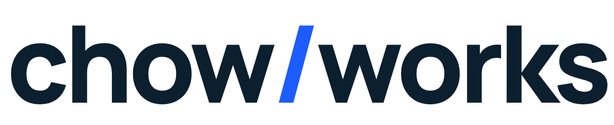
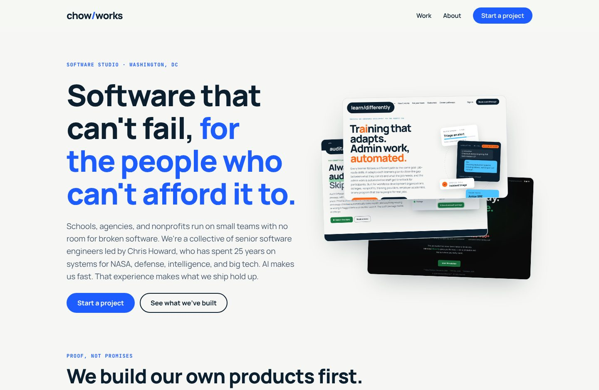

<p align="center">
  <picture>
    <source media="(prefers-color-scheme: dark)" srcset="assets/brand/logo-dark.png">
    
  </picture>
</p>

<p align="center">
  <strong>Software for schools, government, nonprofits, and the people who run them.</strong><br>
  A Washington, DC collective of senior software engineers.
</p>

<p align="center">
  <a href="https://chow.works">chow.works</a> ·
  <a href="https://chow.works/build/">Start a project</a> ·
  <a href="https://chow.works/work/">Work</a> ·
  <a href="https://chow.works/about/">About</a>
</p>

<p align="center">
  
</p>

---

## What's here

The source for [chow.works](https://chow.works): plain HTML, CSS, and JavaScript with no framework and no build step, served by GitHub Pages.

| Path | Page |
| --- | --- |
| `/` | Home: our products as proof, the animated development process, who we build for |
| `/build/` | Start a project. The intake form, linked from chrishoward.fyi |
| `/work/` | Product showcase: learn/differently, audit/differently, interview/differently, Travel HQ |
| `/about/` | The collective, and Chris Howard's 25 years |
| `/404.html` | Not found, which routes back to /build |

```
.
├── index.html            home
├── build/ work/ about/   one index.html each
├── 404.html
├── assets/
│   ├── site.css          all styles
│   ├── site.js           nav, intake form, development-process animation
│   ├── img/              product screenshots
│   └── brand/            logos and README preview
├── favicon.svg / .ico, apple-touch-icon.png, og-image.png
└── CNAME                 chow.works
```

## Run it locally

```sh
python3 -m http.server 8000
# open http://localhost:8000
```

Links are root-relative (`/build/`), so open the site through a server rather than as a file.

## Brand


The `chow/works` wordmark puts Chow.Works in the same family as its products, learn/differently and audit/differently: the same slash, navy, paper, and typeface, with blue as the house color.

| Token | Hex | Use |
| --- | --- | --- |
| Works blue | `#1d5cff` | Primary, the slash, buttons |
| Navy | `#0b1f2e` | Text, dark bands, footer |
| Paper | `#f6f7f4` | Page background |
| Sky | `#5cc8ff` | Accents on navy |

The type is **Manrope** for everything, plus **JetBrains Mono** for small labels. The mark (`favicon.svg`) is drawn as paths, so it renders anywhere without fonts.

## Before launch

1. **Pages:** in Settings → Pages, deploy from `main` at the root. `CNAME` is already set to `chow.works`.
2. **DNS (Spaceship):** add A records for `chow.works` pointing to `185.199.108.153`, `185.199.109.153`, `185.199.110.153`, and `185.199.111.153`, plus a `www` CNAME pointing to `chowworks.github.io`.
3. **Intake form:** the form posts through [FormSubmit](https://formsubmit.co) to `contact@chow.works`. The first submission sends an activation email to that inbox. Click the link once, and every later submission arrives.
